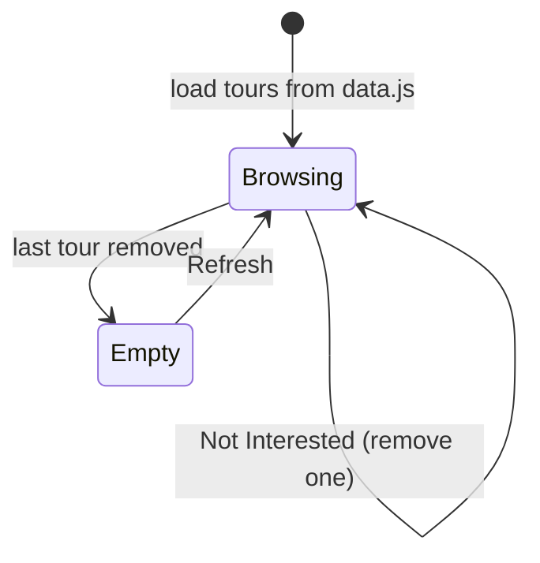

<div align="center">

# 🧳 Tour Planning — "Plan With Shariq"

**Browse Indian tour packages, read more about the ones you like and remove the ones you don't — a clean React app for shortlisting your next trip.**

[](https://tour-planning.vercel.app)


[Features](#-features) · [How it works](#-how-it-works) · [Getting Started](#-getting-started) · [Structure](#-project-structure)

</div>

---

## ✨ Features

| | Feature |
|---|---|
| 🗺️ | **Tour cards** — destinations like Agra, Jaipur, Goa and Varanasi with image and price |
| 📖 | **Read more / show less** for long descriptions (first 200 characters by default) |
| ❌ | **Not Interested** removes a tour from the list |
| 🔄 | **Refresh** brings every tour back once the list is empty |

## 🔄 How it works



## 🚀 Getting Started

```bash
git clone https://github.com/Shariq2003/Tour_Planning.git
cd Tour_Planning
npm install
npm start            # http://localhost:3000
```

<details>
<summary><b>✏️ Add your own tours</b></summary>

Edit [`src/data.js`](src/data.js):

```js
{
  id: "unique-id",
  name: "Udaipur",
  info: "Long description of the trip…",
  image: "https://…",
  price: "45,000",
}
```

</details>

## 📁 Project Structure

<details>
<summary><b>Expand tree</b></summary>

```text
src/
├── components/
│   ├── Cards.jsx    # list of tours
│   └── Card.jsx     # single tour, read-more toggle, remove button
├── data.js          # tour packages
└── App.js           # state, remove & refresh
```

</details>

---

<div align="center">

Built by **[Shariq](https://github.com/Shariq2003)** · [LinkedIn](https://www.linkedin.com/in/shariq-sd)

⭐ If you like this project, consider giving it a star!

</div>
